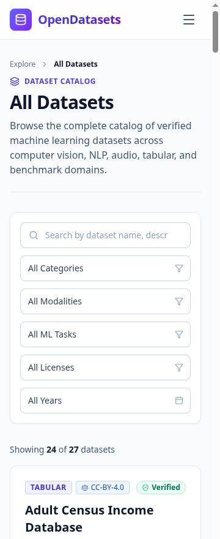
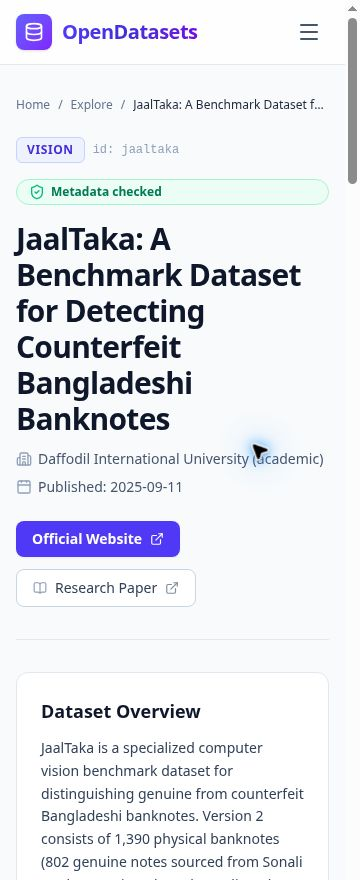

# Keyboard and mobile review — 29 October 2026

## Findings recorded before changes

The catalog had no skip-to-main link. Its mobile menu exposed expanded state but
no controlled navigation ID or Escape/focus-return behavior. Repeated “View
Details” links did not identify their dataset to assistive technology. Result
counts were not announced after filtering. Scroll-reveal cards could stay visually
hidden when reached through keyboard focus. Home/About copy described unavailable
data-profiling functionality.

## Changes

- Added a visible-on-focus skip link and a focusable main landmark.
- On pathname navigation, reset scroll and move focus to main without interfering
  with query-only filter edits.
- Added global focus indicators, larger control targets and reduced-motion rules.
- Connected the mobile menu button to a named navigation region. Escape closes
  it and returns focus to its trigger; choosing a route closes the menu.
- Reveal a card when a descendant receives focus and identify each details link.
- Announce dataset result counts with a polite status region.
- Allow badge/footer wrapping and constrain long detail grid content.
- Distinguish metadata/source checks from data quality and retain unknown values.

## Browser checks

Used the rendered app in a same-origin iframe fixed to 360 CSS pixels, not a claim
of testing every physical phone. The iframe's vertical scrollbar can reduce its
layout viewport to 345px. Checked the home, explorer, listing, About, and a long
JaalTaka detail page for horizontal overflow. Measured document scroll width no
larger than the layout viewport in the checked states.

Verified keyboard Tab reaches the skip link, Enter focuses main, mobile menu
expands, Escape closes it and returns focus, and keyboard activation opens dataset
details. Search for MNIST returned two matching records; searching JaalTaka returned
one. Verified focus moves to main on detail navigation. These are targeted manual
checks, not a WCAG conformance certification or a full screen-reader audit.

## Hosted follow-up

Repeated JaalTaka search, pointer detail navigation, no-horizontal-overflow
measurement (360px layout and scroll width), and mobile menu Escape/focus return
against the public GitHub Pages application embedded in the 360px QA frame.
