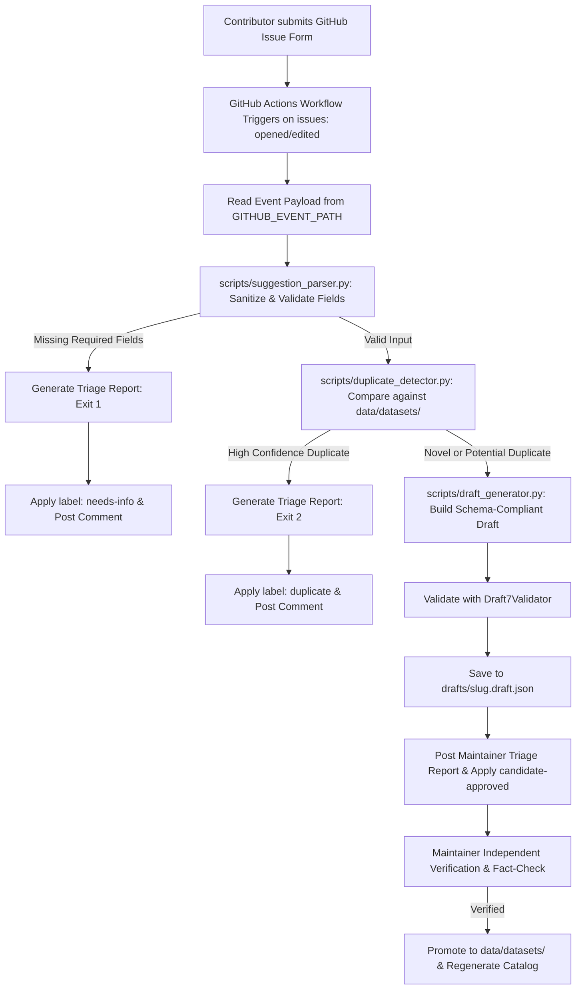

# OpenDatasets Community Contribution Automation Architecture

This document describes the design, security boundaries, duplicate detection engine, and workflow procedures for automatically triaging community dataset suggestions submitted via GitHub Issues.

---

## 1. Objective & Core Principles

OpenDatasets is a free, open-source catalog of machine learning benchmark datasets. As the catalog expands beyond 100 records, community suggestions must be triaged efficiently without compromising scientific metadata accuracy or security.

### Core Principles

1. **Zero External Dependencies:** No backend servers, databases, paid cloud services, or AI API dependencies. Everything runs locally or within standard GitHub Actions runners.
2. **Untrusted Input Containment:** All contributor submissions are treated as untrusted text. Input is sanitized and never evaluated or passed unquoted to shell interpreters.
3. **Draft Isolation:** Draft metadata is **never** written directly to `data/datasets/` or the published `catalog.json`. Drafts are stored in a dedicated `drafts/` directory or ephemeral CI artifacts until human maintainer verification.
4. **Checking vs. Verification:** Automated tools perform syntactic checks, schema validation, URL format verification, and duplicate matching. **Human maintainers** independently verify scientific truth, download payloads, sample distributions, and legal licensing terms.
5. **Strictly Provisional Status:** Generated drafts are strictly marked `verification.status: "provisional"`. Never mark community contributions as `"verified"` automatically.

---

## 2. End-to-End Triage Flow



---

## 3. Component Architecture

### 3.1 Suggestion Parser (`scripts/suggestion_parser.py`)
- **Input:** Raw markdown body from GitHub Issue Form (`.github/ISSUE_TEMPLATE/dataset_suggestion.yml`).
- **Sanitization:** Removes null bytes (`\x00`) and ASCII control characters (`\x00-\x1f\x7f`), preserving valid whitespace (`\t`, `\n`) and full Unicode (including Bangla and non-Latin scripts).
- **Field Extraction:**
  - `Dataset name`: Validated for 2–150 characters.
  - `Official dataset URL`: Validated for HTTP/HTTPS scheme and valid domain netloc without network requests.
  - `Modality, task, and usefulness`: Extracts category, primary task, and description (minimum 10 characters).
  - `License information`: Extracts licensing terms, defaulting to unknown if unspecified.
  - `Additional evidence and limitations`: Uses regex to extract scientific DOIs (`10.xxxx/...`), paper URLs, and maintainer notes.
- **Error Handling:** Rejects `_No response_` placeholders and missing required fields with clear, actionable error messages.

### 3.2 Duplicate Detector (`scripts/duplicate_detector.py`)
Compares incoming candidates against all published records in `data/datasets/*.json` across five dimensions:

| Match Dimension | Normalization / Heuristic | Confidence Level | Action |
| --- | --- | --- | --- |
| **Exact ID / Slug** | Lowercase kebab-case exact string equality | `high_confidence` | Flag duplicate (Exit 2) |
| **Exact Name** | Case-insensitive stripped string equality | `high_confidence` | Flag duplicate (Exit 2) |
| **Normalized Name** | Strips punctuation and stop words (`dataset`, `benchmark`, etc.) | `high_confidence` | Flag duplicate (Exit 2) |
| **Canonical URL** | Scheme-agnostic, strips default ports, trailing slashes, and UTM tracking parameters | `high_confidence` | Flag duplicate (Exit 2) |
| **Canonical DOI** | Lowercase, strips `doi.org` prefixes and trailing punctuation | `high_confidence` | Flag duplicate (Exit 2) |
| **Token Overlap (Jaccard)** | Word token intersection / union (>= 0.75) | `potential_duplicate` | Flag for maintainer review |
| **Fuzzy Similarity** | Levenshtein / SequenceMatcher ratio (>= 0.85) | `potential_duplicate` | Flag for maintainer review |

*Note: Novel suggestions with minor word overlap are flagged as `potential_duplicate` for human triage rather than rejected automatically.*

### 3.3 Draft Generator (`scripts/draft_generator.py`)
Transforms a parsed suggestion into a complete draft JSON conforming to `schemas/dataset.v1.schema.json`:
- **Slug / ID Generation:** Converts names to kebab-case ASCII matching `^[a-z0-9]+(-[a-z0-9]+)*$`. For non-Latin or Bangla names, generates deterministic safe hashes (e.g., `dataset-da3bf381`).
- **Modality Mapping:** Maps keywords into schema enums (`vision`, `nlp`, `audio`, `tabular`, `multimodal`, `reinforcement-learning`, `graph`, `time-series`, `sensor`, `3d`, `other`).
- **Publisher Inference:** Recognizes authoritative academic/government domains (e.g. `archive.ics.uci.edu`, `physionet.org`, `stanford.edu`, `.edu`, `.gov`). For unknown domains, labels as unverified publisher without fabricating entities.
- **License Structuring:** Maps common open licenses (CC BY 4.0, MIT, Apache 2.0, Public Domain) to standard SPDX IDs. If unverified, sets `license.status: "unknown"` and `license.commercial_use: "unknown"`.
- **Provisional Status:** Enforces `"verification": {"status": "provisional", "verified_by": null, "verified_date": null}`.
- **Provenance Audit Trail:** Records issue number, contributor notes, and unverified caveats in `provenance.curation_notes`.
- **Schema Validation:** Evaluates draft in-memory with `jsonschema.Draft7Validator`.

### 3.4 Orchestrator CLI (`scripts/process_suggestion.py`)
Provides a single unified command-line entrypoint:
```bash
# Process raw markdown string
python3 scripts/process_suggestion.py --issue-body "### Dataset name..."

# Process file
python3 scripts/process_suggestion.py --issue-file /path/to/issue.md

# Process GitHub event payload in CI
python3 scripts/process_suggestion.py --event-path "$GITHUB_EVENT_PATH" --output-dir drafts/ --json
```

**Exit Codes:**
- `0`: Valid suggestion; draft created.
- `1`: Validation/parsing failure; missing required fields.
- `2`: Duplicate detected with high confidence.

---

## 4. The Checking vs. Verification Policy

In OpenDatasets, **checking** and **verification** are strictly distinct operational phases:

| Phase | Automated Tooling (Checking) | Human Maintainer (Verification) |
| --- | --- | --- |
| **URL** | Confirms HTTP/HTTPS format and domain syntax. | Navigates to landing page, confirms dataset exists and is accessible. |
| **DOI / Paper** | Extracts regex `10.xxxx/...` and checks format. | Reads paper abstract to confirm it matches the claimed dataset. |
| **License** | Identifies declared text and maps known SPDX IDs. | Checks actual source license terms, disclaimers, and data vs code splits. |
| **Sample Counts** | Preserves user claims in provenance notes. | Audits row counts, class distributions, and train/test splits. |
| **Payload Size** | Leaves field omitted or sets status `unknown`. | Downloads archive or inspects content-length header. |
| **Status Tag** | Sets strictly `"status": "provisional"`. | Promotes to `"status": "verified"` upon documented audit. |

---

## 5. Security & Containment Architecture

Because GitHub Issues are publicly open to any user, all contributions must be treated as untrusted input:

1. **No Code Execution:** Contributor input is never passed to `eval()`, `exec()`, or template engines.
2. **Safe GitHub Event Handling:** GitHub Actions workflows must **never** interpolate untrusted text directly into shell scripts:
   ```bash
   # DANGEROUS: Remote script injection vulnerability
   python3 scripts/process_suggestion.py --issue-body "${{ github.event.issue.body }}"

   # SECURE: Read structured payload directly from disk
   python3 scripts/process_suggestion.py --event-path "$GITHUB_EVENT_PATH"
   ```
3. **Least Privilege:** Workflows triaging community issues require only:
   ```yaml
   permissions:
     contents: read
     issues: write
   ```
4. **Draft Isolation:** Draft files are written to `drafts/`, which is ignored by `.gitignore` and excluded from `scripts/generate_catalog.py`.

---

## 6. GitHub Actions Workflow Design (`dataset-suggestion.yml`)

The automated triage workflow runs under strictly isolated permissions (`contents: read`). It does not comment on issues, modify labels, or open pull requests automatically. Triage results are surfaced via GitHub Actions Job Summaries (`$GITHUB_STEP_SUMMARY`) and downloadable artifacts:

```yaml
name: Dataset Suggestion Triage

on:
  issues:
    types: [opened]

permissions:
  contents: read

concurrency:
  group: dataset-suggestion-${{ github.event.issue.number }}
  cancel-in-progress: false

jobs:
  triage:
    name: Triage Dataset Suggestion
    runs-on: ubuntu-latest
    timeout-minutes: 5

    steps:
      - name: Checkout repository
        uses: actions/checkout@v4

      - name: Set up Python 3.11
        uses: actions/setup-python@v5
        with:
          python-version: '3.11'
          cache: pip
          cache-dependency-path: requirements-dev.txt

      - name: Install dependencies
        run: |
          python -m pip install --upgrade pip
          pip install -r requirements-dev.txt

      - name: Process dataset suggestion
        id: triage_step
        run: |
          mkdir -p triage_output drafts
          python3 scripts/process_suggestion.py \
            --event-path "$GITHUB_EVENT_PATH" \
            --output-dir drafts \
            --report-file triage_output/report.md \
            --summary-file "$GITHUB_STEP_SUMMARY" \
            --json > triage_output/result.json || true

          python3 -c "
          import json, os
          with open('triage_output/result.json', 'r', encoding='utf-8') as f:
              data = json.load(f)
          with open(os.environ['GITHUB_OUTPUT'], 'a', encoding='utf-8') as out:
              out.write(f'status={data.get(\"status\", \"\")}\n')
              out.write(f'is_valid={str(data.get(\"is_valid\", False)).lower()}\n')
              out.write(f'slug={data.get(\"slug\", \"\")}\n')
              out.write(f'draft_path={data.get(\"draft_path\", \"\") or \"\"}\n')
          "

      - name: Upload maintainer review report
        if: always() && hashFiles('triage_output/report.md') != ''
        uses: actions/upload-artifact@v4
        with:
          name: triage-report-issue-${{ github.event.issue.number }}
          path: triage_output/report.md
          retention-days: 30

      - name: Upload provisional draft metadata
        if: steps.triage_step.outputs.status == 'valid' && steps.triage_step.outputs.draft_path != ''
        uses: actions/upload-artifact@v4
        with:
          name: draft-metadata-issue-${{ github.event.issue.number }}
          path: ${{ steps.triage_step.outputs.draft_path }}
          retention-days: 30
```

---

## 7. Maintainer Verification & Publication Guide

When a suggestion receives `candidate-approved`:
1. Download the draft JSON or review the triage comment.
2. Fact-check the landing page, publication DOI, and licensing agreement.
3. If accurate:
   ```bash
   # Move verified draft to published catalog
   cp drafts/<slug>.draft.json data/datasets/<slug>.json

   # Update verification metadata
   # Set verification.status: "verified", verified_by: "OpenDatasets Maintainers", verified_date: "YYYY-MM-DD"

   # Regenerate catalog and validate
   python3 scripts/validate_datasets.py
   python3 scripts/generate_catalog.py
   pytest
   cd frontend && npm test -- --run && npm run build
   ```
4. Commit to a dedicated feature branch and open a review PR referencing the issue.
